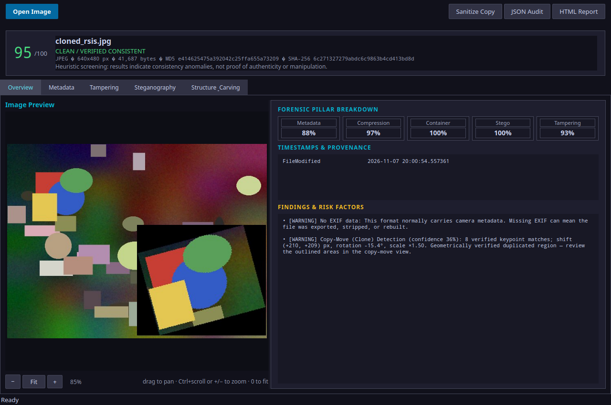
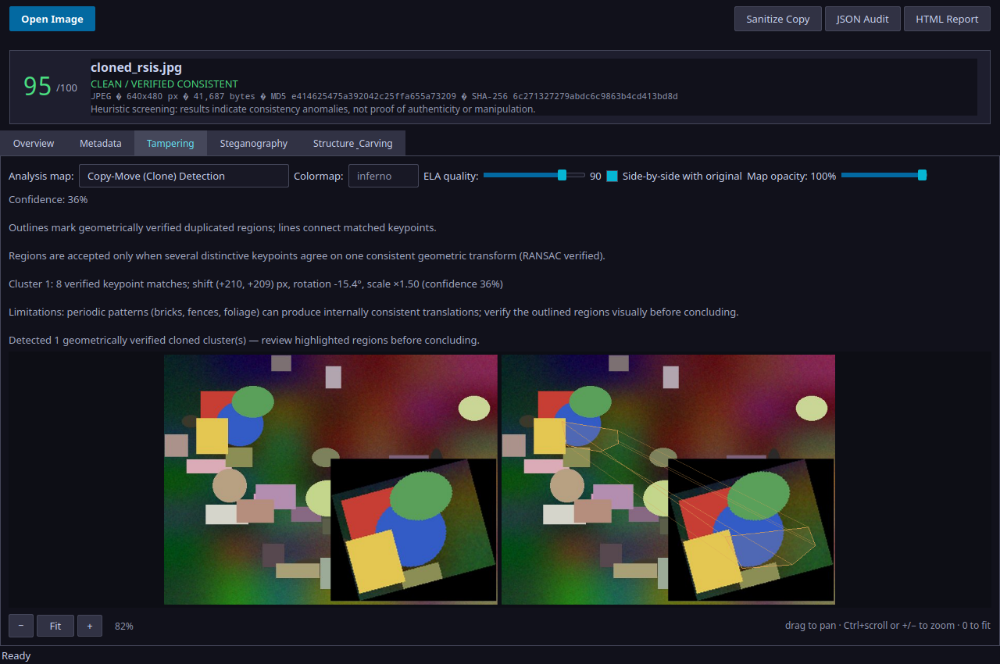
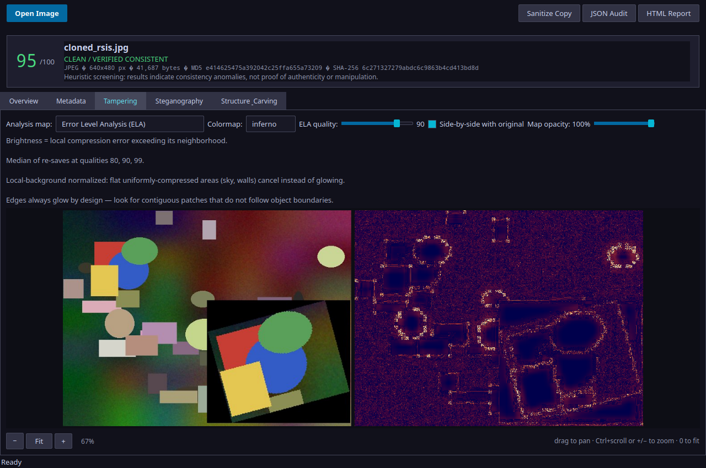
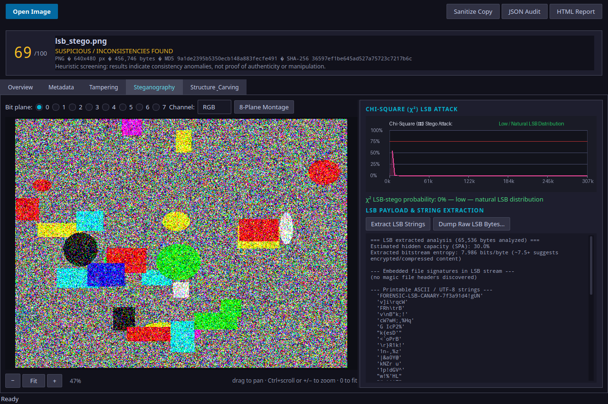
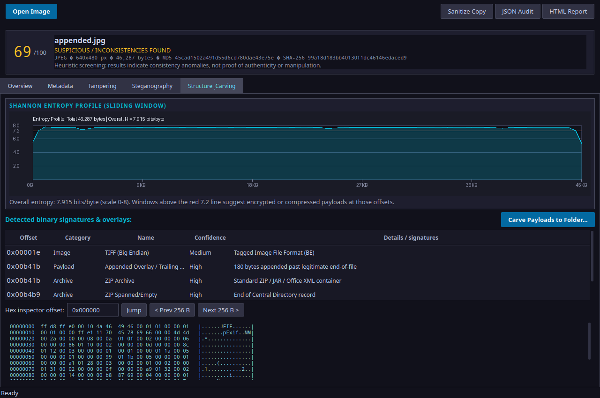

# Pixamine




**Pixamine** is a forensic screening workstation for image authenticity analysis: metadata
consistency, error level analysis, copy-move detection, noise and lighting
analysis, JPEG ghosts, LSB steganalysis, and binary structure carving.
Techniques follow public methods known from tools such as ExifTool, Binwalk,
and zsteg/StegSolve.

Intended users: forensic analysts, investigators, and journalists verifying
image provenance.

> Results are heuristic indicators, not proof. Findings carry confidence
> values and limitation notes; keep original files and verify hashes before
> drawing conclusions.

## Screenshots

| | |
|---|---|
|  |  |
| **Copy-move detection** — geometrically verified clone with shift, rotation and scale | **Error Level Analysis** — original vs. local-background-normalized heatmap |
|  |  |
| **Steganalysis** — bit planes, χ² attack, LSB payload extraction | **Structure & carving** — entropy profile, signature table, hex inspector |

## Features

- **Deep metadata**: EXIF, XMP, IPTC, ICC profiles, MakerNotes
  (Nikon/Canon/Apple), PNG/WebP chunks, GPS with OpenStreetMap/Google Maps
  links, JSON GeoJSON export.
- **Consistency findings**: timestamp logic, editor/software tags, dimension
  and thumbnail mismatches, JPEG marker anomalies — each with severity and
  plain-language explanation.
- **Tamper views** (with side-by-side comparison and map blending):
  - **ELA**: median of three re-save qualities on luminance with
    local-background subtraction — flat areas cancel instead of glowing.
  - **Copy-move detection**: SIFT + Lowe ratio test + RANSAC partial-affine
    consensus with spatial-compactness filtering; reports shift, rotation and
    scale of each verified clone.
  - **Noise map**: median-filter residual + robust local MAD with a texture
    reliability mask.
  - **Lighting**: block-wise dominant gradient angle with coherence gating.
  - **JPEG ghost**: recompression sweep with best-fit quality distribution.
  - **Thumbnail diff**: embedded camera preview vs. current pixels + SSIM.
- **Steganalysis**: bit planes 0–7 and 8-plane montage, LSB string/payload
  extraction, Westfeld χ² attack, Dumitrescu–Wu–Wang sample pair analysis
  (calibrated against known embedding rates).
- **Binary forensics**: sliding-window entropy profile, 31-signature scanner
  with structural validators, trailing-overlay detection, payload carving,
  hex inspector.
- **Scoring**: five-pillar authenticity scorecard (0–100) with per-finding
  confidence values and limitation notes.
- **Reporting**: standalone HTML dossier, machine-readable JSON audit,
  metadata CSV export; metadata-free sanitized copies.

## Quick Start

```bash
git clone <repository>
cd pixamine
python3 -m venv .venv
source .venv/bin/activate
pip install -r requirements.txt
python3 app.py                # workstation
python3 app.py sample.jpg     # open an image directly
```

Keyboard: `Ctrl+O` open · `0` fit · `+`/`−` zoom · arrows pan · drag pans ·
scroll zooms. High zoom uses nearest-neighbor sampling so real pixels stay
sharp. Exports (HTML report, JSON audit, metadata CSV), payload carving, and
metadata-free sanitized copies are available from the toolbar and tab panels.

## Architecture

```
├── app.py                # Entry point: launches the Qt workstation
├── pipeline.py           # GUI-free orchestration (runs on worker threads)
├── carver.py             # Entropy profile, signature scanner, carver, hex dump
├── stego.py              # Bit planes, LSB extractor, chi-square, SPA
├── tamper_analysis.py    # ELA, clone detection, lighting, noise, ghost, thumbnail
├── metadata_engine.py    # Deep metadata, MakerNotes, ICC profiles, GPS, sanitizer
├── scoring.py            # Five-pillar authenticity scoring with confidences
├── reporting.py          # HTML dossier & JSON report generators
├── forensics.py          # Metadata consistency findings
├── jpeg_structure.py     # JPEG marker, quantization table, IPTC parser
├── exif_utils.py         # EXIF/XMP/thumbnail extraction helpers
├── ui/                   # PySide6 front end (no analysis code lives here)
│   ├── theme.py          # Design system (palette, QSS)
│   ├── controller.py     # Central state layer; dispatches worker threads
│   ├── workers.py        # QThread workers (analysis, maps, lab jobs)
│   ├── viewer.py         # QGraphicsView image viewer (zoom/pan)
│   ├── models.py         # Qt table models: metadata, signatures
│   ├── tabs.py           # Overview / Metadata / Tampering / Steganography / Carving tabs
│   ├── tooltip.py        # Hover tooltips for technical terms
│   └── main_window.py    # Toolbar, verdict banner, tab notebook, status bar
└── tests/
    ├── fixtures.py       # Known-authentic and known-manipulated sample generator
    ├── run_metrics.py    # Detector validation harness
    └── feature_tests.py  # Full feature verification (31 checks)
```

The analysis modules and `pipeline.py` import no UI toolkit: algorithms run
and are tested headlessly, and the GUI never blocks — all heavy work runs on
worker threads with progress signals.

## Dependencies (and why)

| Library | License | Chosen because |
|---|---|---|
| Pillow | MIT-CMU | Image I/O, EXIF thumbnail access |
| NumPy | BSD | Array math for every detector |
| PySide6 | LGPL-3.0 | Full Qt 6: real accessibility layer (UIA/AT-SPI), QGraphicsView viewer, model/view, threads |
| opencv-python-headless | Apache-2.0 | SIFT keypoints + RANSAC partial-affine for copy-move detection |
| SciPy | BSD | Exact χ² survival function (Westfeld attack), median/uniform filters for noise residual |
| scikit-image | BSD | SSIM for embedded-thumbnail consistency |
| piexif | MIT | Test fixtures only: writes realistic camera EXIF with embedded thumbnails |

## Detector notes

- **Copy-move**: validated on a deterministic fixture set — detects verbatim
  and rotated/scaled clones; zero clusters on clean and repetitive textures
  (a naive block matcher produced 658 phantom clusters on a brick pattern
  while missing a verbatim clone).
- **χ² attack**: Westfeld–Pfitzmann PoV equalization with the exact scipy
  survival function and the correct one-sided statistic; detects sequential
  payloads.
- **SPA**: faithful implementation of Dumitrescu–Wu–Wang sample pair analysis
  (quadratic eq. 6); calibrated 0.10/0.25/0.50 true rates →
  0.10/0.26/0.51 estimated on scattered payloads.
- **ELA / noise / lighting / ghost**: hardened against the classic false
  positives (flat regions, chroma edges, texture noise, recompression) — see
  inline notes and the per-view "How to read it" panel.
- Noise-inconsistency auto-flagging is deliberately **not** wired into the
  score: validation showed adjacent-block noise conflict cannot separate
  spliced from natural imagery on compressed content. The noise map remains a
  visual tool with limitation notes.

## Testing

```bash
python tests/run_metrics.py /tmp/metrics.json validation   # detector validation
python tests/feature_tests.py                              # full feature pass (31 checks)
```

Both suites regenerate the fixture set automatically on first run (authentic
camera JPEG with full EXIF and thumbnail, screenshot PNG, periodic texture,
re-saved image, verbatim clone, rotated+scaled clone, splice, scattered and
sequential LSB stego, appended ZIP). Fixture ground truth is documented in
`tests/fixtures.py`. Continuous integration runs both suites on Python
3.11–3.13 (`.github/workflows/tests.yml`).

## Contributing

See [CONTRIBUTING.md](CONTRIBUTING.md) — in short: detector changes need a
before/after `run_metrics.py` validation, analysis stays out of `ui/`, and
nothing blocks the UI thread.

## License

[MIT](LICENSE). The bundled dependencies carry their own permissive licenses
(see the table above); PySide6 is LGPL-3.0 and is used as a dynamically
linked, unmodified library.
